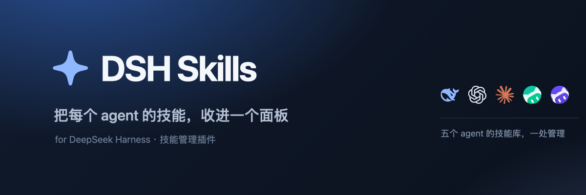

# dsh-skills

[English](README.md) | 中文



在 DeepSeek Harness 左侧导航中加入一行 **技能**，以及点击后打开的技能管理页面。

[安装](#安装) · [下载 v0.1.0](https://github.com/yixin2021/dsh-skills/releases/latest) ·
[介绍页](https://yixin2021.github.io/dsh-skills/)（`github.io` 在部分网络中不可达，见文末）

DSH 会从用户目录和项目目录下的 `.dsh/skills`、`.agents/skills` 中发现 Agent 技能，
但本身没有提供查看已安装技能、或在不改文件的前提下临时关掉某个技能的界面。
本插件补上这块。

## 面板能做什么

| | |
|---|---|
| **总览** | DSH 扫描的每一个根目录，以及每个技能的名称、描述、指令文件路径和调用策略。 |
| **预览** | 直接在应用内读完整的 `SKILL.md`——frontmatter 与正文。 |
| **启用 / 停用** | 每个技能一个开关。停用的技能字节不动，仍留在磁盘上。 |
| **安装** | 把顶层含 `SKILL.md` 的文件夹复制进指定根目录。原目录不会被移动。 |
| **从 GitHub 导入** | 粘贴 GitHub 仓库、目录或技能链接；一个仓库可以一次批量导入多个技能。冲突或超限时整批拒绝，不覆盖也不留下半成品。 |
| **新建技能** | 用表单写一个带合法 frontmatter 的技能包。 |
| **安全卸载** | 卸载只是把条目移进根目录下的 `.trash`，之后可恢复，也可彻底删除。 |
| **定位** | 在访达 / 资源管理器 / 桌面文件管理器中显示技能或根目录。 |
| **自动识别** | Codex、Claude Code、WorkBuddy、CodeBuddy 的技能目录在固定位置，存在的会被自动列出，并带上各自 agent 的图标。 |
| **添加目录** | 把另一个 agent 的技能库挂到面板上——`~/.claude/skills`、同事的仓库、共享的技能包都行。里面的技能会被列出，DSH 也会加载。目录本身仍然是只读的。 |

## 安装

**从 GitHub 安装。** 本仓库就是一个可直接安装的包：`package.json` 在根部，
没有构建步骤，所以任何 npm 兼容的 git 规格都能解析。在插件管理器
（设置 → 插件）里安装：

```
github:yixin2021/dsh-skills
```

同一条规格也适用于 CLI——`dsh plugin` 会把参数原样转给 profile 里的 pnpm：

```sh
dsh plugin --profile desktop add github:yixin2021/dsh-skills
dsh plugin --profile desktop remove dsh-skills
```

`https://github.com/yixin2021/dsh-skills` 与
`git+ssh://git@github.com/yixin2021/dsh-skills.git` 等价。

**从本地目录安装。**

```sh
dsh plugin --profile desktop add /absolute/path/to/dsh-skills
```

bundle patch 会插入一个名为 `skills` 的 Loader 行；客户端部分负责挂载导航行和面板。
安装后刷新窗口即可。

## 实现方式

**宿主侧**（`index.js`）在 `ctx.connection.fetch` 上注册一个需要鉴权的 JSON 路由
`POST /api/dsh-skills`，处理 `list`、`read`、`set-disabled`、`trash`、`restore`、
`purge`、`empty-trash`、`create`、`import-directory`、`import-files`、
`install-from-remote`、`reveal`、`add-root`、`remove-root`；并通过
`ctx.skills.registerProvider` 把自动识别的技能库和手动添加的目录交给模型。
`lib/skills-core.js` 负责技能语法本身——frontmatter 解析、根目录发现、条目扫描——
路由和测试因此共用同一套「什么算一个技能」的定义。

**客户端侧**（`client.js`）在 `sidebar.panellist` 中用 id `dsh-skills` 注册一个图标，
并在 `main` 中注册同一个 id 作为 key 的面板——布局正是靠这个 id 把导航行和面板对上。
它自己从不读技能目录：所有事实都经由路由取得，浏览器没有任何文件系统权限。

### 从 GitHub 导入

仓库里的技能就是一个目录包：`<dir>/SKILL.md` 加上它引用的东西。贴一个链接，
面板会判断它在哪个主机上，把仓库读下来，装进你选的根目录。

| 链接 | 读取方式 |
|---|---|
| `https://github.com/owner/repo` | 走压缩包服务——一次请求，没有速率限制。 |
| `https://github.com/owner/repo/tree/main/skills/foo` | 同上，并定位到该目录。 |
| `https://gitlab.com/owner/repo/-/tree/main/skills/foo` | 先克隆，再定位。 |
| `https://gitee.com/owner/repo/tree/main/skills/foo` | 先克隆，再定位。 |
| `git@host:owner/repo.git` | 通过 SSH 克隆。 |
| `https://host/owner/repo.git#branch` | 克隆指定分支。 |

GitHub 有压缩包接口，一次请求就能拿到整棵树且不限速，所以走这条路；其他 git 主机
一律浅克隆到临时目录，读完立刻删掉。两条路最终得到的是同一棵树，
`lib/skill-tree.js` 统一规定两者都要遵守的策略：哪个目录算一个技能、哪些文件属于它、
哪些路径可以变成文件名。

仓库里含多个技能时，面板会展示复选列表，默认全选，可逐个勾选或清空选择后一次批量导入。
宿主在写盘前检查整批名称、路径和文件限制；任一冲突或超限都不写入，写入失败则回滚本批已创建目录。
分支名里带斜杠（`release/2.0`）时，链接本身说不清分支在哪里结束、路径从哪里开始，
于是把分段依次当作分支试，取那个能读出目标目录的切分。

**私有仓库**需要访问令牌。对话框里有对应输入框，且是可选的：公开仓库不会带令牌，
也就不发送。令牌只用于这一次下载，不会写入磁盘。走 git 克隆时，令牌放在子进程的环境
变量里，而不是命令行——命令行上任何进程都能读到。

**传输协议是收窄的。** `git` 能理解 HTTP 和 SSH 之外的协议，其中有些会执行命令：
`ext::` 会跑一条 shell 命令，`file://` 会读本机磁盘。贴进来的链接绝不能落到这两条路上，
所以在 `git` 看到它之前先按白名单（`https`、`http`、`ssh`、`git`）校验，本地路径按
「不是远程仓库」拒绝，子进程里还有 `GIT_ALLOW_PROTOCOL` 再收一次。克隆还被明确要求
不要提示：后台面板里的凭据提示是一个没人能回答的卡死。

仓库里的任何内容都不会被执行。压缩包在内存里解开，克隆只当文件读，符号链接被跳过而
不跟随，每条路径在变成文件名之前都会重新切段。

### 停用而不删除

DSH 只发现技能根的**直接子项**。被停用的技能会被移到 `<root>/.disabled/<name>`——
隐藏、因此对所有 provider 不可见——重新启用时原样移回。`SKILL.md` 一个字节都不会被改写，
手写的技能可以完整往返。`.trash` 用的是同一套办法。

### 自动识别的 agent 技能库

有五个目录是自动找到的，已经在用别的编码 agent 的机器不需要任何配置。页面按这个
顺序列出：

| 图标 | 技能库 | 路径 |
|---|---|---|
| DeepSeek | DeepSeek Harness | `$DSH_HOME/skills`（通常是 `~/.dsh/skills`） |
| DeepSeek | Agents | `$DSH_AGENTS_HOME/skills`（通常是 `~/.agents/skills`） |
| Codex | Codex | `$CODEX_HOME/skills`（通常是 `~/.codex/skills`） |
| Claude Code | Claude Code | `$CLAUDE_CONFIG_DIR/skills`（通常是 `~/.claude/skills`） |
| WorkBuddy | WorkBuddy | `$WORKBUDDY_HOME/skills`（通常是 `~/.workbuddy/skills`） |
| CodeBuddy | CodeBuddy | `$CODEBUDDY_HOME/skills`（通常是 `~/.codebuddy/skills`） |

每次读取时重新探测，而不是记住结果：以后装了别的 agent 会自动出现，删掉目录也就
从列表里消失。这些技能库和手动添加的目录一样是只读的——那些字节不归 DSH 管。

图标用的是各家公开的品牌素材，不是自己画的：DeepSeek 鲸鱼（simple-icons 的
`deepseek.svg`）、OpenAI 绳结与 Claude 米字（`@lobehub/icons-static-svg` 的
`openai.svg`、`claude.svg`）、以及 codebuddy.ai 和 workbuddy.cn 站点上的官方
`logo.svg`。单色标用 `currentColor`，跟随主题；两个圆标保留各自的渐变。商标归各
自所有，这里只用来标识技能来自哪个 agent。

### 添加的目录

DSH 只扫描固定的几个根目录，所以插件自己注册了一个技能 provider
（`ctx.skills.registerProvider`），用 `source: 'custom'`——DSH 正是为这种情况留的
标签——把这些目录里的技能交给模型。技能目录里的调用策略取自各自的 frontmatter；
用软链接挂进来的技能包也算数（Claude Code 和 stow 都是链接而不是复制）。添加或
移除目录会 invalidate 目录缓存，下一步模型就能看到，无需重启。

目录本身在面板里仍然是**只读**的：没有启用/停用、没有卸载、不能在里面新建，也
不会被当作安装目标。这些字节不归 DSH 管，在那里拨开关等于改别的工具的技能库。
「安装…」是把技能复制进 DSH 自己的根目录。这条规则在宿主侧同样强制执行
（`code: 'read-only'`），不依赖页面自觉。

列表存在 `$DSH_HOME/skills-roots.json`——放在技能旁边而不是 profile 里，这样重建
profile 不会丢，Web 端和桌面端也共用同一份。文件损坏时按空列表处理，下一次
「添加目录」会把它重写。key 由路径哈希而来，移除前面某个目录不会让后面目录的
筛选条件指错地方。

### 边界

所有写操作都经过 `resolveWithin`，路径一旦离开根目录即被拒绝。技能名需匹配
`^[A-Za-z0-9][A-Za-z0-9._-]{0,63}$`；请求的条目必须确实存在于它声称的位置；
新建或安装不会覆盖已存在（含已停用、已在回收站）的同名条目。从远程导入遵守同样的
规则：路径在变成文件名之前会重新切段，仓库里的符号链接被跳过而不跟随。

## UI 规范

- 只使用宿主主题 token（`--dsw-alias-*`），没有自带调色板，深色与浅色主题都成立。
- 所有可见文案取自由宿主语言快照选中的中英双词典（`inject: ['slots', 'locale']`），
  并订阅 `locale/change` 在切换语言时重绘；导航行 label 是函数，同样跟随切换。
  刻意不读 `navigator.language`：在桌面壳里它反映的是系统 Chromium 语言，
  并不跟随宿主的渲染语言。
- 这里的 `React` 是宿主裁剪过的对象，只暴露 `createElement`、`useState`、`useEffect`。
  面板只用这三个；`useSyncExternalStore`、`useRef`、`memo` 之类都是 `undefined`，
  在渲染时调用会抛错，最终表现为面板空白。
- 不引入任何 Harness 客户端包。所有控件都是普通元素 + 主题 token 样式，
  不会因为缺少原语模块或属性名猜错而挂掉。
- 弹层带 `role="dialog"` / `aria-modal`，支持 Esc 与点击遮罩关闭；
  启用/停用是带可访问名称的真实 checkbox。
- 除面板之外的 DOM 一律不碰；除选择文件夹时临时插入、关闭即移除的 input 外，
  不向 `document.body` 追加任何节点。

## 测试

```sh
npm test
```

先对七个源文件跑 `node --check`，再在真实临时目录和测试自建的样例上跑 90 项测试：
frontmatter 解析（引号标量、注释、块标量、非法布尔写法）、路径包含、根目录发现、
仅扫描直接子项、以及包括各种拒绝分支在内的全部变更操作——再加上远程导入这条链路：
链接解析、传输协议白名单、tar 读取，以及克隆。

## 关于介绍页

介绍页发布在 GitHub Pages（<https://yixin2021.github.io/dsh-skills/>）。`*.github.io`
在部分网络（含中国大陆多数网络）会被干扰：TCP 能连上，TLS 握手直接被重置，浏览器表现为
「无法访问」。仓库本身、Releases、README 上的图片都不受影响。

页面源码就在 `docs/index.html`，本地直接打开即可；要放到自己的域名下，把 `docs/` 整个
目录丢给任意静态托管，再在该仓库 Settings → Pages 里填自定义域名（或 `docs/CNAME`）。

## 已知限制

- `import-files` 以文本传输，不携带二进制文件；需要资源文件时用 `import-directory`，
  或安装后再把资源复制进技能包。
- 添加的目录由本插件提供，而不是 DSH 自己扫描。若某个组合里没有 `skills` 服务，
  面板照常工作，但那些目录会退回「只浏览、可复制」。
- 从添加的目录「安装」技能会在磁盘上留下两份副本；原目录不会被移动。
- 面板显示的是根目录当前的状态，不监听文件系统；在磁盘上改过文件后请点「刷新」。
- 从远程导入需要机器上有 `git`（GitHub 之外的主机），或者链接指向 GitHub 仓库。
- 仓库是整份读取的：很大的仓库意味着一次下载或一次浅克隆，超过 24 MB 的压缩包会被
  直接拒绝，而不是下载下来。
